 

I build Minecraft plugins for Paper and Velocity, mostly in Kotlin on top of the Surf-API.
Still learning, one plugin at a time.

 

### `~/stack`

`languages/` 

`learning/` 

`ides/` 

`ai/` 

`build-and-deploy/` 

`daily/` 

Also: Pelican for game servers, Coolify for deployments.

 

### `~/stats`

&nbsp;

 

### `~/contact`

