 

I build Minecraft plugins for Paper and Velocity, mostly in Kotlin on top of the
[Surf-API](https://github.com/SLNE-Development/surf-api). I'm a junior developer and moderator on
the CastCrafter network and work on its projects as part of
[SLNE-Development](https://github.com/SLNE-Development). Still learning, one plugin at a time.

Next to that I build web apps with Next.js and Laravel, a few Android and desktop apps, and run my
own servers under timonso.de.

 

### Projects

| | |
|---|---|
| **[Timonso Labs](https://github.com/Timonso-1/TimonsoRepositorys)** | Portfolio page that lists my GitHub projects, organisations and activity. Next.js, React, Tailwind CSS. |
| **[Brixo](https://github.com/Timonso-1/Brixo)** | A small learning language with German syntax: you program a robot that builds with bricks. Kotlin desktop IDE. |

 

### What I work with

**Languages** 

**IDEs** 

**AI** 

**Frameworks** 

**Infrastructure** 

**Tools** 

Also: Pelican for game servers, Coolify for deployments.

 

### Stats

&nbsp;&nbsp;

&nbsp;&nbsp;

 

### Contact

